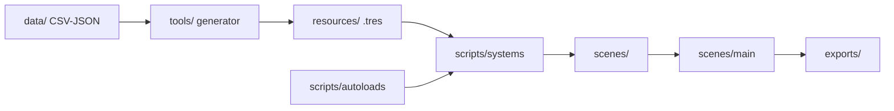

# Arsitektur — Overview

> Versi: 0.1 | Berlaku: Godot 4.6 | Terkait: `../../project.godot`, `../gdd/11-technical.md`

## 1. Prinsip

1. **EventBus untuk koordinasi, bukan untuk kata "kembalian".** Sinyal = notifikasi. Kalau butuh nilai, panggil fungsi query (`has_item()`, `get_health()`).
2. **Resource adalah data, Node adalah perilaku.** Data item/quest/enemy tidak boleh disimpan sebagai hardcode di script.
3. **Scene punya satu tanggung jawab.** `Player.tscn` menggerakkan player, bukan mengelola quest.
4. **Autoload sesedikit mungkin.** Hanya 4 saat ini; tambah autoload butuh ADR.

## 2. Autoload Saat Ini

| Nama | File | Tanggung jawab | Tidak boleh |
| --- | --- | --- | --- |
| `EventBus` | `scripts/autoloads/EventBus.gd` | Deklarasi sinyal global | Menyimpan state / logika |
| `GameManager` | `scripts/autoloads/GameManager.gd` | State machine, pause | Mengurus inventory/quest |
| `SaveManager` | `scripts/autoloads/SaveManager.gd` | Serialisasi & slot save | Tahu struktur UI |
| `AudioManager` | `scripts/autoloads/AudioManager.gd` | Bus, music, SFX | Memicu gameplay logic |

Semua autoload memakai `call_deferred("_connect_signals")` di `_ready()` agar urutan inisialisasi aman.

## 3. Peta Direktori & Tanggung Jawab

| Folder | Isi | Aturan |
| --- | --- | --- |
| `addons/` | Plugin eksternal | Jangan edit isi plugin; patch lewat fork |
| `assets/art/` | Tekstur, model, sprite | Nama: `<kategori>_<nama>_<variant>.png` |
| `assets/audio/` | Music, sfx, voice | Lihat `../gdd/10-audio.md` |
| `scenes/main/` | `Main.tscn`, bootstrap | Satu entry point |
| `scenes/world/` | Fragment, chunk, prop | Scene turunan `WorldFragment` |
| `scenes/characters/` | Player, NPC | Turunan `CharacterBody3D` |
| `scenes/enemies/` | Musuh & bos | Turunan `EnemyBase` |
| `scenes/gameplay/` | Interactable, pickup, build | Turunan `Interactable` |
| `scenes/ui/` | HUD & menu | Hanya baca state, emit aksi |
| `scripts/autoloads/` | 4 file di atas | — |
| `scripts/main/` | `Main.gd` (bootstrap M0) | Hanya inisialisasi & transisi state |
| `scripts/systems/` | Inventory, Quest, Build, Craft | Logika murni, ideally Node |
| `scripts/world/` | ChunkManager, spawner | — |
| `scripts/utils/` | Helper statis | Tanpa state global |
| `resources/` | `.tres` hasil generate | Jangan edit manual |
| `data/` | CSV/JSON source | Source of truth |
| `tests/` | gdUnit4 | Mirror struktur `scripts/` |
| `tools/` | Editor script & generator | Dijalankan via `--script` |
| `exports/` | Build hasil export | Di-gitignore |

## 4. Scene Tree Utama (rencana M1)

```text
Main (Node)                         # scripts/main/Main.gd
├── World (Node3D)                  # container fragment aktif
│   ├── ChunkManager (Node3D)
│   ├── Player (CharacterBody3D)    # autoload-spawned di runtime
│   └── EnemyContainer (Node3D)
├── UI (CanvasLayer)
│   ├── HUD
│   ├── BuildWheel
│   ├── MenuPause
│   └── NotificationToast
└── Debug (CanvasLayer)             # hanya saat OS.is_debug_build()
```

Node di luar `World` tidak boleh membuat `Node3D` sebagai child — gunakan container yang sudah ada.

## 5. Dependency Rules



- `resources/` **tidak** boleh `preload` scene.
- `scripts/utils/` **tidak** boleh memanggil autoload.
- UI **boleh** mendengar EventBus dan memanggil query, tapi **tidak** boleh mengubah state gameplay langsung.

## 6. Pola yang Dipakai

| Pola | Dipakai untuk | Contoh |
| --- | --- | --- |
| Signal Bus | Event lintas modul | `EventBus.item_collected` |
| State Machine | Game state & enemy AI | `GameManager.State` |
| Resource-driven data | Item, quest, Suit | `ItemDef`, `QuestDef` |
| Object Pool | Balok, projectile, SFX | `Pool<T>` di `scripts/utils/` |
| Service Locator (terbatas) | Autoload | `SaveManager.save_game()` |
| Command + Undo | Build Mode | `BuildCommand` stack |

## 7. Layer Collision (3D)

| Layer | Nama | Dipakai oleh |
| --- | --- | --- |
| 1 | `world` | Terrain, struktur statis |
| 2 | `player` | Player body |
| 3 | `enemy` | Musuh |
| 4 | `hitbox` | Serangan player |
| 5 | `hurtbox` | Area terima damage |
| 6 | `pickup` | Balok & item |
| 7 | `interactable` | NPC, terminal, beacon |
| 8 | `build_ghost` | Preview placement |

Mask diatur supaya `hitbox` hanya tabrakan dengan `hurtbox` + `world`, bukan `pickup`.

## 8. Konvensi Penamaan

| Objek | Konvensi | Contoh |
| --- | --- | --- |
| Script | `snake_case.gd` | `build_mode.gd` |
| Class name | `PascalCase` | `class_name BuildMode` |
| Scene | `PascalCase.tscn` | `BuildWheel.tscn` |
| Resource | `snake_case.tres` | `item_brick.tres` |
| Sinyal | `past_tense` | `item_collected` |
| Fungsi query | `is_/has_/get_` | `has_item()` |
| Konstanta | `UPPER_SNAKE` | `SAVE_VERSION` |
| Autoload reference | PascalCase | `EventBus.emit...` |

## 9. Keputusan Arsitektur

Catat keputusan besar lewat template [ADR](../templates/adr-template.md):

- ADR-001 — Menggunakan EventBus sentral (draft)
- ADR-002 — Sistem dialog: custom resource vs Dialogic (belum diputus)
- ADR-003 — GDScript vs C# untuk sistem hot-path (belum diputus)

## 10. Checklist Review Arsitektur

- [ ] Tidak ada `get_node("/root/...")` selain di autoload
- [ ] Tidak ada data gameplay di `.tscn` (selain default visual)
- [ ] Semua event lintas sistem punya deklarasi di `EventBus`
- [ ] Autoload baru punya ADR
