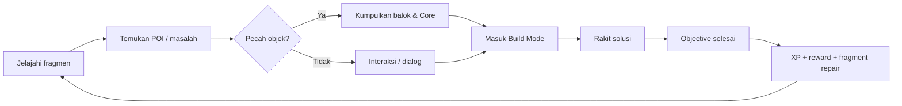

# GDD 01 — Core Gameplay Loop

> Versi: 0.1 | Terkait: `00-overview.md`, `02-world-design.md`, `07-quests.md`

## 1. Loop Utama (30 detik – 3 menit)

**Inti loop:** *Lihat sesuatu yang rusak → pecah ambil balok → rakit perbaikan → dunia jadi lebih utuh → buka area baru.*

## 2. Lapisan Loop

| Lapisan | Durasi | Pertanyaan yang dijawab pemain | Contoh |
| --- | --- | --- | --- |
| **Moment** | 5–30 dtk | "Balok apa yang kudapat dari benda ini?" | Memecah patung, balok beterbangan |
| **Session** | 20–45 mnt | "Fragmen apa yang bisa kuperbaiki hari ini?" | Menyelesaikan 2 Build Contract + 1 quest samping |
| **Long-term** | 6–20 jam | "Seberapa jauh Great Build pulih?" | 5 Fragment restored → akses ke lokasi final |

## 3. Moment-to-Moment (detik ke detik)

1. **Traversal** — lari/lompat/canopy swing; kamera mengikuti dengan easing ringan.
2. **Scan** — tekan `Q` untuk *Builder Vision*: objek interaktif beroutline kuning, balok biru, musuh merah.
3. **Break** — serangan atau grapple melepaskan balok; ada *satisfaction pop* (suara klik + particle + skor Studs).
4. **Collect** — balok melayang ke pemain (magnet radius 2 m), tanpa perlu pickup manual.
5. **Build** — `B` masuk Build Mode, waktu pelan, grid snap, pilih blueprint dari radial wheel.
6. **Verify** — struktur "nyala" jika valid; objective marker berubah hijau.
7. **Reward** — XP, Studs, dan potongan Fragment muncul dengan feedback audio-visual.

## 4. Prinsip Desain Loop

- **Setiap aksi punya hasil terlihat.** Tidak ada "klick yang sia-sia".
- **Biaya balok rendah, ide mahal.** Jangan hukum eksperimen gagal — balok dikembalikan 100% saat structures dibongkar (M2).
- **Selalu ada "next shiny thing".** POI berikutnya terlihat dari posisi saat ini (menara, beacon, glow).
- **Progresi terlihat di dunia.** Makin banyak fragment pulih, langit makin terang — progress bar dunialah, bukan cuma angka UI.

## 5. First 10 Minutes (Onboarding)

| Menit | Aktivitas | Yang diajarkan | Gating |
| --- | --- | --- | --- |
| 0–1 | Cutscene singkat + kontrol dasar | Move, kamera, lompat | Tidak bisa gagal |
| 1–3 | Pecah 3 objek di Nexus | Break → magnet collect | Balok terkumpul otomatis |
| 3–5 | Builder Vision + radial wheel | Baca warna & pilih blueprint | Hanya 1 blueprint tersedia |
| 5–7 | Quest pertama: "Perbaiki Jembatan Nexus" | Snap & place | Grid menyorot titik valid |
| 7–9 | Jembatan jadi, NPC menyeberang | Build = solusi | NPC memberi quest berikutnya |
| 9–10 | Waypoint Beacon aktif | Fast travel & peta | Save otomatis pertama |

> Aturan onboarding: **tidak ada teks panjang**. Gunakan ikon kontekstual + satu baris hint yang hilang setelah aksi berhasil.

## 6. Engagement & Retention

| Mekanik | Fungsi |
| --- | --- |
| Daily-ish *Build Contract* (opsional, non-FOMO) | Alasan kembali tanpa tekanan |
| Collectible *Blueprint Fragment* | Eksplorasi maze & hidden area |
| Kombo pecah (5 objek berturut = bonus Studs) | Skill expression |
| Fotografis "Build Gallery" (M4) | Ekspresi & sharing (lokal dulu) |
| fragment repair visual | Komitmen emosional |

## 7. Anti-Pola yang Dihindari

- ❌ Grinding material berulang untuk satu pintu → cukup 1–2 pecahan unik per gate.
- ❌ Fetch quest tanpa perubahan dunia → setiap quest mengubah state dunia.
- ❌ Backtracking tanpa fast travel → Beacon aktif sejak awal tiap fragmen.
- ❌ Timer yang menghukum eksplorasi → Build Mode melambatkan waktu, bukan menghentikan.

## 8. Checklist Implementasi

- [ ] `BuildMode` state masuk `GameManager.State` ( tambah `BUILD` di M2 )
- [ ] `EventBus.structure_built` dipancarkan saat placement valid
- [ ] Objective tracker mendengar `quest_objective_updated`
- [ ] Tutorial flow punya telemetri lokal (tanpa data pribadi) di build debug
