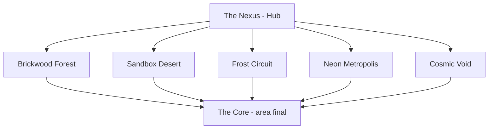

# GDD 02 — World Design

> Versi: 0.1 | Terkait: `01-core-loop.md`, `11-technical.md`

## 1. Struktur Dunia

Dunia terdiri dari **1 Hub + 5 World Fragment** yang melayang di *Infinity Expanse*.

Akses: Nexus → 2 fragmen awal. Tiap fragment yang pulih membuka 1 fragmen baru + 1 reward Suit. The Core terbuka setelah 5/5 fragment.

## 2. The Nexus (Hub)

- **Fungsi:** spawn, save, builder bench, peta, NPC guide "Pixel", portal ke fragmen.
- **Ukuran:** ± 120×120 m, tidak di-stream (selalu loaded).
- **Perubahan dinamis:** makin banyak fragment pulih → Nexus makin lengkap (jembatan, taman, lampu).
- **POI:** Save Terminal, Blueprint Vault, Suit Station, Mission Board, Portal Ring.

## 3. Bioma

| Fragment | Tema | Build Rule unik | Warna dominan | Musuh khas |
| --- | --- | --- | --- | --- |
| Brickwood Forest | Hutan balok raksasa | Tanaman tumbuh dari balok yang ditanam | Hijau / coklat | Vine Crawler |
| Sandbox Desert | Gurun kotak pasir | Balok tenggelam/bergeser seperti pasir | Kuning / oranye | Dune Roller |
| Frost Circuit | Es + sirkuit | Permukaan licin, balok konduktif | Biru / putih | Frost Byte |
| Neon Metropolis | Kota malam futuristik | Balok melayang di magnet track | Ungu / cyan | Neon Drone |
| Cosmic Void | Ruang hampa berbintang | Gravitasi rendah, balok bisa ditempatkan di udara | Hitam / emas | Void Shard |

> **Build Rule** = modifikasi aturan merakit di bioma tersebut. Ini membuat tiap fragmen terasa baru tanpa menambah sistem yang benar-benar berbeda.

## 4. Sistem Chunk & Streaming

- Ukuran chunk: **64×64 m** (konfigurabel via `WorldSettings`).
- Radius loaded: **2 chunk** di sekitar pemain; unload di > 3 chunk (hysteresis).
- Setiap fragmen ≈ 12–20 chunk; total aktif ≤ 40 chunk.
- Chunk berisi: `TerrainLayer`, `PropsLayer`, `EnemySpawner`, `POIMarker`.
- Data chunk disimpan di `data/world/<fragment>/chunk_<x>_<z>.json` (generated by tool).
- Objek breakable yang sudah dipecah menyimpan state di save file, bukan di chunk file.

## 5. Point of Interest (POI)

| Tipe | Frekuensi | Reward |
| --- | --- | --- |
| Build Puzzle | 2–3 / chunk | Blueprint Fragment |
| Enemy Camp | 1–2 / chunk | Studs + Core shard |
| NPC Encounter | 1 / 2 chunk | Quest samping |
| Hidden Cache | 1–3 / chunk | Suit material |
| Waypoint Beacon | 1 / fragmen + 2 opsional | Fast travel |
| Fragment Shrine | 1 / fragmen | Story trigger + bos |

**Aturan jarak:** dari POI mana pun, POI berikutnya terlihat atau terpetakan dalam ≤ 90 detik perjalanan.

## 6. Traversal

| Gerakan | Unlock | Catatan |
| --- | --- | --- |
| Run / Jump | Awal | Dasar |
| Double Jump | Fragment 1 | Suit "Featherstep" |
| Grapple Brick | Fragment 2 | Menarik balok & menarik diri |
| Air Dash | Fragment 3 | Suit "Comet" |
| Magnet Glide | Fragment 4 | Melayang di udara dengan balok |
| Zero-G Hop | Fragment 5 | Kontrol gravitasi lokal di Cosmic Void |

Fast travel via Beacon, bukan teleport bebas — menjaga sense of scale.

## 7. Siklus Waktu

- Siklus 12 menit real-time (siang 8 mnt, malam 4 mnt).
- Dampak: pencahayaan, musuhSpawn table, warna Builder Vision.
- Tidak ada hukuman malam hari; malam = variasi + quest khusus tertentu.
- Bisa di-skip di menu pause (aksesibilitas).

## 8. Peta & Navigasi

- **Nexus Map** (tab peta): menampilkan fragmen, Beacon aktif, POI yang sudah ditemukan.
- **Objective Compass** di HUD: panah ke objective aktif + jarak meter.
- **Builder Vision (`Q`)**: highlight interaktif dalam radius 30 m.
- Marker belum ditemukan = abu-abu; ditemukan = putih; selesai = hijau.

## 9. Aturan Environment Storytelling

Setiap fragmen punya "bekas luka" dari Great Shatter: patung patah, jembatan putus, kota setengah melayang. Pemain **melihat** kerusakan sebelum membaca dialog. Dialog hanya memberi nama pada apa yang sudah terlihat.

## 10. Checklist Implementasi

- [ ] `WorldFragment` resource: `id`, `biome`, `build_rule`, `unlock_requirement`
- [ ] `ChunkManager` dengan load/unload radius
- [ ] Beacon interaction → `EventBus.area_entered`
- [ ] State prop pecah tersimpan di `SaveManager`
