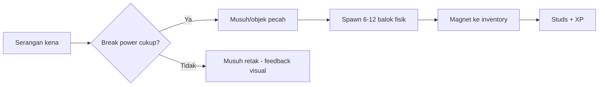

# GDD 04 — Combat

> Versi: 0.1 | Terkait: `03-character-system.md`, `05-progression.md`

## 1. Filosofi

Combat dalam game ini **bukan tentang membunuh**, melainkan **membongkar**. Musuh adalah kumpulan balok yang bisa dipecah jadi material. Tidak ada darah; musuh "bercantol" (pop) menjadi balok dan Studs. Ringan, lucu, dan tetap memuaskan.

> Prinsip: *serangan yang baik terasa seperti memecah mainan, bukan menyakiti makhluk.*

## 2. Statistik Dasar

| Stat | Player awal | Cap | Sumber |
| --- | --- | --- | --- |
| HP | 100 | 180 | Level, Suit Bulwark |
| Melee damage | 12 | 30 | Blueprint Tree |
| Gadget damage | 8 | 22 | Upgrade |
| Attack speed | 1.0× | 1.6× | Suit |
| Break power | 1 | 4 | Suit "Builder", hammer blueprint |
| Shield | 0 | 40 | Bulwark, perisai balok |

## 3. Sumber Damage

### 3.1 Melee — `Left Click`
- Kombo 3 hit: *tap → tap → heavy swing*.
- Hit ke-3 memecah 2 balok musuh sekaligus.
- Bisa di-charge (hold 0.6 dtk) untuk *Mega Swing* (3× damage, cooldown 4 dtk).
- Serangan ke objek environment menghasilkan balok (sama seperti ke musuh).

### 3.2 Gadget — `Right Click`
| Gadget | Unlock | Efek | Cooldown |
| --- | --- | --- | --- |
| Brick Blaster | Awal | Projectile 8 dmg, menjatuhkan 2 balok | 1.2 dtk |
| Grapple Hook | Fragment 2 | Tarik balok / tarik diri ke musuh | 3 dtk |
| Stun Pulse | Blueprint | AoE 3 m, stun 1.5 dtk | 8 dtk |
| Magnet Mine | Sandbox | Tarik musuh lalu meledak | 10 dtk |

### 3.3 Build-Based Combat (M2)
- **Turret balok** menembak otomatis (biaya 12 balok, durasi 30 dtk).
- **Perisai** memblokir 40 damage, pecah setelahnya.
- **Katapel** melempar balok ke musuh (damage tergantung jumlah balok).

## 4. Sistem Break & Loot



- Balok yang jatuh punya fisika ringan 0.8 dtk lalu magnet ke pemain.
- Drop dijamin minimal 3 balok; sisanya random sesuai `drop_table`.
- **Musuh elite/bos** butuh break power 2+ untuk pecah total.

## 5. Jenis Musuh

| Musuh | Bioma | HP | Perilaku | Drop khas |
| --- | --- | --- | --- | --- |
| Brick Grunt | Semua | 30 | Maju lurus, melee | 6 balok, 5 Studs |
| Vine Crawler | Brickwood | 45 | Serang dari atas, dash | 8 balok, vine core |
| Dune Roller | Sandbox | 60 | Menggulung, pantul dinding | 10 balok, sand core |
| Frost Byte | Frost Circuit | 50 | Serangan es, slow | 8 balok, frost core |
| Neon Drone | Metropolis | 40 | Terbang, projectile | 7 balok, neon chip |
| Void Shard | Cosmic Void | 70 | Teleport pendek | 12 balok, void core |

**Archetype AI:** Patrol → Detect (radius 12 m) → Chase → Attack → Retreat (HP < 25%) → Pop.

## 6. Bos Guardian (1 per Fragment)

| Bos | Fragment | Mekanik unik | Strategi inti |
| --- | --- | --- | --- |
| The Rootmind | Brickwood | Menumbuhkan balok jadi rintangan | Bangun katapel untuk meraih kepala |
| The Dune Colossus | Sandbox | Tenggelam & muncul | Magnet pad untuk menahan posisi |
| The Frost Circuit | Frost Circuit | Mengisi lantai dengan es | Relay balok untuk mengalirkan panas |
| The Neon Overlord | Metropolis | Melayang di magnet track | Bangun menara untuk sejajar |
| The Void Mirror | Cosmic Void | Kloning dirinya 3× | Zero-G hop + pecah semua clone |
| **The Shatterer** | The Core | Mengubah arena jadi 3 build rule bergantian | Kuasai semua mekanik + rebuild cepat |

**Aturan bos:** setiap bos punya ** weakness berbasis build**, bukan sekadar DPS. Ada telegraph jelas ≥ 1 dtk sebelum serangan berbahaya.

## 7. Difficulty & Fairness

- Tidak ada *permadeath*. Respawn 3 dtk di checkpoint terdekat.
- Musuh tidak respawn di radius 40 m dalam 60 dtk (anti-farm).
- Opsi **Accessibility**: damage masuk 0.5×, telegraph lebih lama, auto-aim gadget.
- Skala musuh mengikuti Creator Level, tapi **quest tidak pernah terkunci** karena level.

## 8. Feedback Matrix

| Event | Visual | Audio | Haptic (controller, M5) |
| --- | --- | --- | --- |
| Hit | Flash putih 0.08 dtk | *clack* | Short pulse |
| Pop | Balok beterbangan | *crackle-pop* | Medium pulse |
| Player hit | Vignette merah | *thud* | Strong pulse |
| Boss phase | Layar bergetar + warna berubah | Music sting | Long pulse |

## 9. Implementasi (rencana)

```text
scripts/enemies/EnemyBase.gd       # state machine + health + drop
scripts/enemies/BossBase.gd        # phase + telegraph
resources/characters/enemy_brick_grunt.tres
resources/items/drop_table_grunt.tres
scenes/enemies/BrickGrunt.tscn
```

Sinyal: `EventBus.player_health_changed`, `player_died`, `item_collected`.

## 10. Checklist

- [x] `Hitbox`/`Hurtbox` dengan layer collision yang jelas (Area3D projectile + group `enemy`/`breakable`)
- [x] Drop table sebagai `.tres`, bukan hardcode (`resources/items/drop_table_grunt.tres`)
- [x] Test: break power 1 vs elite → tidak pecah total (`tests/test_enemy_combat.gd`)
- [x] Test: kematian tidak mengurangi balok inventory (`tests/test_enemy_combat.gd`)

### Catatan implementasi M2 (phase combat)
- `CombatMath.gd` berisi kalkulasi murni: combo 3 hit, heavy hit ke-3 (break power 2), Mega Swing (3×, cooldown 4 dtk), dan reduksi damage saat break power kurang.
- `EnemyBase.gd` mengikuti archetype AI Patrol → Detect → Chase → Attack → Retreat → Pop.
- `BrickGrunt` memakai `EnemyDef` + `DropTableDef` dari `.tres`; 2 instance ada di `Main.tscn`.
- `BrickProjectile` (klik kanan) = 8 damage, cooldown 1.2 dtk, dan tidak aktif saat Build Mode.
- Belum masuk: bos, gadget Grapple/Stun/Mine, build-based combat (turret/perisai/katapel), dan telegraph serangan.
