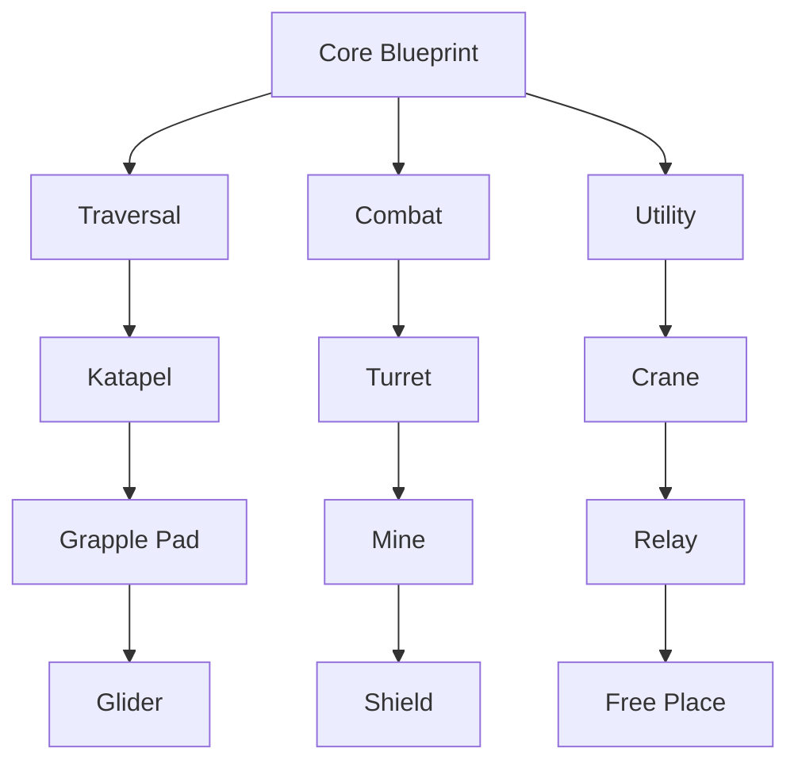

# GDD 05 — Progression

> Versi: 0.1 | Terkait: `03-character-system.md`, `07-quests.md`, `11-technical.md`

## 1. Dua Lapis Progresi

| Lapis | Nama | Fungsi | Terlihat di dunia? |
| --- | --- | --- | --- |
| Horizontal | **World Fragment** | Membuka area & bioma baru | ✅ Ya — langit & Nexus berubah |
| Vertikal | **Creator Level** | Membuka blueprint, Suit, stat | ⚠️ Sebagian (Suit visual) |

Prinsip: **progresi dunia lebih penting dari angka**. Naik level terasa seperti "dunia membesar", bukan cuma damage naik.

## 2. Creator Level (XP)

| Level | XP kumulatif | Unlock |
| --- | --- | --- |
| 1 | 0 | Starter Suit, 3 blueprint |
| 2 | 100 | Katapel, +5 HP |
| 3 | 250 | Suit Builder, undo 3 langkah |
| 5 | 600 | Turret balok |
| 8 | 1.400 | Magnet Pad, grid presisi |
| 10 | 2.200 | Suit Architect |
| 15 | 4.000 | Free Place, 5 undo |
| 20 | 6.000 | Suit Voidwalker cosmetic, Build range maks |

Kurva: `XP(level) = 50 × level × (level + 1)` (kumulatif disesuaikan di tabel di atas untuk pacing).

### Sumber XP

| Aktivitas | XP | Catatan |
| --- | --- | --- |
| Objective quest selesai | 40–150 | Skala dengan panjang quest |
| Fragment Shrine | 300 | Once per fragment |
| Bos dikalahkan | 250 | Once |
| Build puzzle pertama kali | 25 | Tidak repeatable |
| POI ditemukan | 10 | Once per POI |
| Musuh elite | 20 | Diminishing returns |

> **Anti-grind:** musuh biasa memberi 0 XP. XP datang dari *discovery* dan *problem solving*.

## 3. Blueprint Tree

Tree bercabang 3, bukan linear:

- Node dibuka dengan **Blueprint Fragment** (dari puzzle/chest), bukan XP.
- XP hanya membuka *slot* untuk node; Fragment membuka node itu sendiri.
- Pemain bisa memilih urutan cabang → build berbeda tiap playthrough.

### Status Implementasi M2
`BlueprintTree` (autoload, ADR-006) memuat 8 node dari `resources/blueprints/*.tres`. Node root cabang (`fragment_cost = 0`, level 1) terbuka otomatis.

| Node | Cabang | Level | Fragment | Prasyarat | Reward |
| --- | --- | --- | --- | --- | --- |
| `traversal_root` | traversal | 1 | 0 | — | gate cabang |
| `catapult` | traversal | 2 | 1 | `traversal_root` | blueprint katapel |
| `featherstep` | traversal | 2 | 1 | `traversal_root` | Suit Featherstep |
| `combat_root` | combat | 1 | 0 | — | gate cabang |
| `bulwark` | combat | 3 | 2 | `combat_root` | Suit Bulwark |
| `utility_root` | utility | 1 | 0 | — | gate cabang |
| `builder` | utility | 3 | 1 | `utility_root` | Suit Builder |
| `architect` | utility | 5 | 2 | `builder` | Suit Architect |

Sumber Fragment saat ini: quest `sq_001` dan `bc_002` (1 each). UI dibuka dengan `T`; alasan kegagalan unlock ditampilkan per node (`Butuh Creator Lv N`, `Butuh node sebelumnya`, `Butuh N Fragment`). Status node ikut tersimpan di `SaveGame` lewat `BlueprintTree.to_dict()/from_dict()`.

## 4. World Fragment Gating

| Fragment | Syarat | Reward utama |
| --- | --- | --- |
| Brickwood Forest | Awal (dari Nexus) | Suit Featherstep |
| Sandbox Desert | Selesaikan 1 Build Contract | Suit Magnet |
| Frost Circuit | Restore Fragment 1 | Suit Comet |
| Neon Metropolis | Restore Fragment 2 | Suit Freehand |
| Cosmic Void | Restore Fragment 4 | Suit Voidwalker |
| The Core | 5/5 Fragment | Ending + Suit Architect |

## 5. Reward Economy Ringkas

| Sumber | Studs | Balok | Core | Fragment |
| --- | --- | --- | --- | --- |
| Pecah prop | 3–8 | 4–12 | — | — |
| Pecah musuh | 5–20 | 6–12 | — | — |
| Build puzzle | 30 | refund | — | 1 (first clear) |
| Bos | 150 | 40 | 3 | — |
| Fragment Shrine | 200 | 60 | 5 | — |

## 6. Aturan Balansi

- **Biaya blueprint ≤ 60% balok yang bisa dikumpulkan di area** → pemain tidak pernah "macet".
- Setiap gate butuh **maksimal 2 material unik**, tidak need 50 balok.
- Kenaikan HP musuh ≤ 15% per Fragment.
- Pemain yang tidak naik level tetap bisa menyelesaikan quest (skill > stat).

## 7. Telemetri & Tuning (debug only)

| Metrik | Target |
| --- | --- |
| Waktu rata-rata menuju Level 3 | < 20 menit |
| Fragment pertama selesai | 45–75 menit |
| Rasio XP quest : XP eksplorasi | 60 : 40 |
| Pemain "terjebak" > 5 mnt di puzzle | < 10% |

Data dikumpulkan lokal di `user://debug/telemetry.json`, hanya di build debug, tanpa identitas pribadi.

## 8. Checklist

- [ ] `CreatorLevel` resource dengan kurva XP
- [ ] `BlueprintTree` data di `resources/upgrades/`
- [ ] Fragment unlock condition sebagai `Resource`, bukan `if` bersebaran
- [ ] Test: XP tidak terisi ulang saat load save
