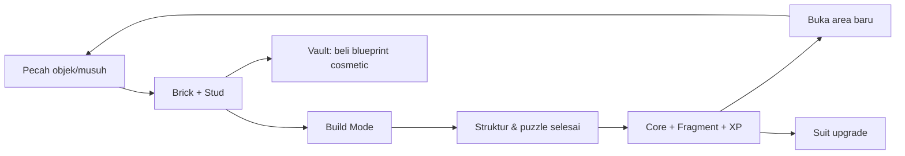

# GDD 06 — Items & Economy

> Versi: 0.1 | Terkait: `01-core-loop.md`, `05-progression.md`

## 1. Empat Jenis Currency / Material

| Nama | Ikon | Fungsi | Faucet (sumber) | Sink (pemakaian) |
| --- | --- | --- | --- | --- |
| **Brick** | 🧱 | Material merakit universal | Pecah objek & musuh | Place blueprint |
| **Stud** | ⚙️ | Currency beli kosmetik/upgrade | Pecah objek, quest | Blueprint Vault, Suit Station |
| **Core** | 💠 | Bahan portal & fragment repair | Bos, shrine, cache | Buka fragmen, upgrade Suit |
| **Blueprint Fragment** | 📐 | Buka node Blueprint Tree | Puzzle, hidden cache | Unlock blueprint |

Prinsip: **Brick harus melimpah, Core harus terasa spesial.** Jangan pernah membuat pemain menunggu Brick.

## 2. Inventory

- **Weightless**, tanpa batas balok (sesuai design pillar "ramah untuk semua").
- Dipisah jadi 4 tab: `Materials`, `Blueprints`, `Suits`, `Collectibles`.
- Stack otomatis; balok tidak perlu dipilih satu-satu saat build.
- Quick wheel menampilkan 8 blueprint terakhir + favorit.

### Data Item (resource)

```gdscript
class_name ItemDef
extends Resource

@export var id: StringName
@export var display_name: String
@export var category: ItemCategory
@export var icon: Texture2D
@export var stack_size: int = 999
@export var sell_value: int = 0
@export var description: String
```

File: `resources/items/brick_standard.tres`, dll. Source table mentah di `data/items.csv` → generator `.tres` via `tools/generate_items.gd`.

## 3. Drop Table

Contoh `resources/items/drop_table_grunt.tres`:

| Item | Min | Max | Chance |
| --- | --- | --- | --- |
| Brick | 6 | 10 | 100% |
| Stud | 5 | 8 | 100% |
| Frost Core | 1 | 1 | 12% (bioma Frost saja) |

Aturan: selalu ada drop minimal. Tidak ada "kosong" setelah memecah sesuatu.

## 4. Crafting & Build Cost

- **Tidak ada crafting tradisional** dengan workstation wajib. Build Mode = crafting.
- Biaya blueprint ditampilkan di ghost (mis. `Jembatan: 12 🧱`).
- Bongkar struktur → **refund 100%** (M2). Salah pasang bukan kerugian.
- Suit Station di Nexus: tukar **Stud + Core** untuk upgrade Suit (bukan balok).

### Contoh biaya

| Blueprint | Brick | Stud | Core |
| --- | --- | --- | --- |
| Jembatan 4 m | 12 | 0 | 0 |
| Katapel | 18 | 5 | 0 |
| Turret | 12 | 0 | 0 |
| Magnet Pad | 20 | 10 | 1 |
| Portal Stabilizer | 40 | 50 | 5 |

## 5. Economy Flow



## 6. Balansi Awal

| Metrik | Target |
| --- | --- |
| Brick diperoleh per menit eksplorasi | 40–80 |
| Biaya rata-rata 1 puzzle | 15–30 Brick |
| Stud untuk 1 Suit upgrade | 120–300 |
| Core per Fragment | 5 (shrine) + 3 (bos) |
| Rasio dapat:pakai Brick | ≈ 1.4 : 1 |

## 7. Aturan Anti-Frustrasi

- ✅ Refund penuh saat bongkar.
- ✅ Magnet otomatis balok (tidak perlu jemput satu-satu).
- ✅ Tidak ada durability / repair.
- ✅ Tidak ada inventory penuh.
- ❌ Tidak ada biaya untuk membuka peta / fast travel.
- ❌ Tidak ada "tax" saat respawn.

## 8. Collectibles

| Tipe | Jumlah | Reward |
| --- | --- | --- |
| Blueprint Fragment | 25 | Buka cabang tree |
| Golden Stud | 30 / fragmen | Stud + cosmetic |
| Postcard (foto lokasi) | 15 | Lore snippet |
| Minifigure relic | 10 | Display di Nexus |

## 9. Checklist

- [ ] `ItemDef` & `DropTable` resource
- [ ] Inventory autosave lewat `EventBus.inventory_changed`
- [ ] Refund logic di `BuildMode.dismantle()`
- [ ] Test: biaya > inventory → ghost merah, tidak bisa place
