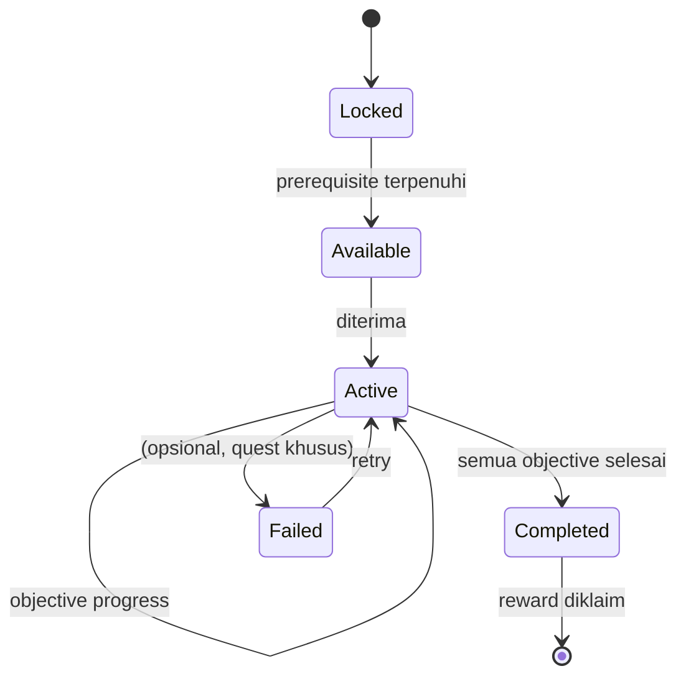

# GDD 07 — Quests

> Versi: 0.2 | Terkait: `05-progression.md`, `09-narrative.md`, `../design/adr/ADR-004-inventory-quest-autoload.md`

## 1. Jenis Quest

| Tipe | Prefix ID | Durasi | Contoh |
| --- | --- | --- | --- |
| Main Story | `MS_` | 60–120 mnt | "Pulihkan Brickwood Forest" |
| Side Quest | `SQ_` | 5–15 mnt | "Bantu Pixel cari suku cadang" |
| Build Contract | `BC_` | 3–8 mnt | "Bangun menara setinggi 12 m" |
| Bounty | `BT_` | 5–10 mnt | "Pecah 3 Neon Drone" |
| Discovery | `DS_` | Eksplorasi | "Temukan 5 cache tersembunyi" |

Target v1.0: **1 main path (5 chapter) + 15 side + 5 contract + 3 bounty + 2 discovery** (≈ 20–25 quest).

## 2. Struktur Quest (resource)

```gdscript
class_name QuestDef
extends Resource

@export var id: StringName
@export var title: String
@export var quest_type: StringName   # main/side/contract/bounty/discovery
@export var description: String
@export var objectives: Array[Dictionary]
@export var rewards: Dictionary      # {xp, stud, fragment, blueprint, suit}
@export var prerequisites: Array[StringName]
@export var next_quest: StringName
@export var fail_on_player_death: bool
@export var start_active: bool
```

Objective: `{ id, type, target, required, label }` dengan tipe: `collect`, `build`, `defeat`, `interact`, `explore`, `talk`. Implementasi M2 memakai `Array[Dictionary]` (bukan `ObjectiveDef`) agar data `.tres` tetap ringan; `ObjectiveDef` bisa ditambahkan saat Quest Log UI masuk.

## 3. State Machine



- Quest aktif disimpan di save. **Implementasi M2: 1 quest aktif** (target 3 aktif + 1 main untuk Quest Log UI di M4).
- Rantai `next_quest` otomatis membuka quest lanjutan jika prerequisite sudah terpenuhi.
- `fail_on_player_death = true` → state `FAILED`, `quest_failed` dipancarkan, `retry_quest()` mereset progres.
- Objective yang sudah selesai dicentang, bukan hilang → pemain tahu progres.

## 4. Contoh Quest Lengkap

### `BC_001 — "Perbaiki Jembatan Nexus"`

| Field | Isi |
| --- | --- |
| Type | Build Contract (tutorial) |
| Prasyarat | Tutorial break selesai |
| Objective 1 | Kumpulkan 12 Brick (`collect`) |
| Objective 2 | Place blueprint `bridge_4m` di gap (`build`) |
| Objective 3 | Biarkan NPC menyeberang (`interact`) |
| Reward | 40 XP, 30 Stud, blueprint katapel |
| Perubahan dunia | Jembatan permanen, NPC pindah ke seberang |
| Lanjutan | `next_quest = sq_001` ("Bersihkan Nexus", 2 Brick Grunt) → `bc_002` ("Katapel Perdana") |
| Alternatif | Bisa pakai katapel jika sudah unlock (M2) |

## 5. Prinsip Desain Quest

1. **Setiap quest mengubah dunia.** Tidak ada "kembali ke NPC yang sama dan bilang selesai" tanpa efek.
2. **Berikan ≥ 2 solusi** untuk quest build (bangun vs. gadget), kecuali tutorial.
3. **Reward dijelaskan di awal**, tidak kejutan di akhir.
4. **Objective tracker selalu akurat** — sinkron via `EventBus.quest_objective_updated`.
5. **Tidak ada quest yang gagal karena eksplorasi lama.** Tidak ada timer kecuali bos.

## 6. Integrasi Sistem

| Event | Reaksi |
| --- | --- |
| `item_collected` | Objective `collect` bertambah |
| `structure_built` | Objective `build` selesai |
| `enemy_defeated` | Objective `defeat` bertambah |
| `area_entered` | Objective `explore` selesai |
| `dialogue_finished` | Objective `talk` selesai |
| `player_died` | Quest ber-flag `fail_on_player_death` → `FAILED` |
| semua objective done | `EventBus.quest_completed` → reward otomatis → `next_quest` |

`reward.fragment` diterjemahkan menjadi `blueprint_fragment` di Inventory (bukan kunci `cores` seperti di tabel desain awal).

QuestManager menyimpan state di `SaveManager` sebagai:
```json
{
  "active": "bc_001",
  "completed": ["bc_001"],
  "failed": [],
  "progress": { "obj_collect": 12, "obj_build": 1, "obj_cross": 1 },
  "states": { "bc_001": 3, "sq_001": 2, "bc_002": 0 }
}
```
Kode state: `0 = LOCKED, 1 = AVAILABLE, 2 = ACTIVE, 3 = COMPLETED, 4 = FAILED`. Progres disimpan per objective id (flat), bukan bersarang per quest.

## 7. Quest Log UI

- Tab: `Main`, `Side`, `Contracts`, `Completed`.
- Sortir: terdekat, level reward, terbaru.
- Klik quest → panah compass aktif + highlight di peta.
- Opsi "Track" maksimal 1 quest + 1 contract.

## 8. Checklist

- [ ] `QuestDef`, `ObjectiveDef` resource
- [ ] QuestManager dengan state machine & save integration
- [ ] Test: progress tidak dobel saat load save
- [ ] Test: prerequisite multiple tidak menyebabkan quest doaktif
