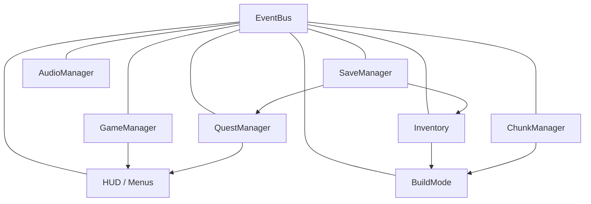

# GDD 11 — Technical Design

> Versi: 0.1 | Terkait: seluruh dokumen | Owner: Tech Lead

## 1. Spesifikasi Target

| Item | Minimum | Target | Rekomendasi |
| --- | --- | --- | --- |
| OS | Windows 10 / Ubuntu 22.04 | Windows 11 / Ubuntu 24.04 | — |
| CPU | 4-core 2.5 GHz | 6-core 3.0 GHz | 8-core |
| RAM | 8 GB | 16 GB | 16 GB |
| GPU | GTX 1050 / Iris Xe | GTX 1660 / RX 5600 | RTX 3060 |
| Storage | 6 GB SSD | 8 GB SSD | NVMe |
| Resolusi | 1280×720 | 1920×1080 | 2560×1440 |
| FPS | 30 (low) | **60 @ 1080p** | 120 (unlocked) |

Renderer **GL Compatibility** dipilih untuk kompatibilitas luas (lihat `project.godot`). Physics: **Jolt**.

## 2. Arsitektur Perangkat Lunak

**Aturan emas:** modul tidak boleh memanggil modul lain secara langsung untuk event lintas sistem — lewat `EventBus`. Dependensi langsung hanya untuk *query* (`get_health()`, `has_item()`).

Detail: [`../architecture/overview.md`](../architecture/overview.md).

## 3. Manajemen Memori & Performa

| Teknik | Detail |
| --- | --- |
| Chunk streaming | 64×64 m, radius load 2, unload 3 |
| Mesh instancing | Balok & prop berulang pakai `MultiMeshInstance3D` |
| Material sharing | 1 material per warna balok, gunakan vertex color |
| Culling | Frustum + occlusion untuk interior |
| LOD | 3 level untuk prop > 20 m |
| Object pool | Balok pecahan, projectile, particle, SFX player |
| Texture atlas | UI & prop kecil → 2 atlas 2048² |
| Physics | Jolt, layer collision terdefinisi, hindari area query tiap frame |

**Budget per frame @ 60 FPS (16.6 ms):**
| Kategori | Budget |
| --- | --- |
| Logic & script | 3 ms |
| Physics | 4 ms |
| Render submit | 5 ms |
| Audio | 1 ms |
| Headroom | 3.6 ms |

## 4. Data Pipeline

| Jenis | Source of truth | Output | Generator |
| --- | --- | --- | --- |
| Item | `data/items.csv` | `resources/items/*.tres` | `tools/generate_items.gd` |
| Quest | `data/quests.csv` | `resources/quests/*.tres` | `tools/generate_quests.gd` |
| Enemy | `data/enemies.csv` | `resources/characters/*.tres` | `tools/generate_enemies.gd` |
| World | `data/world/**/*.json` | chunk scene | `tools/generate_chunks.gd` |
| Dialog | `data/dialog/*.json` | `DialogueDef` | `tools/generate_dialog.gd` |
| Lokalisasi | `data/localization/*.csv` | `.translation` | Godot import |

> Aturan: **jangan edit `.tres` hasil generate langsung**. Edit CSV/JSON lalu jalankan generator. Generator dicek di CI.

## 5. Save System

- Format: JSON di `user://saves/slot_XX.json`, 3 slot + 1 auto.
- Versioning `SAVE_VERSION`; migrasi bertahap lewat `SaveManager._migrate()`.
- Yang disimpan: posisi, HP, inventory, quest progress, Creator Level, fragment status, prop pecah, setting.
- Yang tidak disimpan: enemy posisi (respawn), particle, musik state.
- Auto-save: tiap checkpoint + tiap 5 menit + saat quit.

Detail: [`../architecture/save-system.md`](../architecture/save-system.md).

## 6. Testing

| Level | Tools | Target coverage |
| --- | --- | --- |
| Unit | gdUnit4 | ≥ 70% sistem inti |
| Integration | gdUnit4 + scene test | Quest, inventory, save |
| Playtest | Manual checklist | Tiap milestone |
| Performance | Godot Profiler + `--benchmark` | 60 FPS @ target |
| Smoke | Export build jalan 10 mnt | Tiap rilis |

Test wajib: refund balok, save/load round-trip, quest prerequisite, blueprint cost > inventory, break power vs elite.

## 7. Version Control & CI

- Git + Conventional Commits (lihat `../guides/git-workflow.md`).
- Branch: `main` (stabil), `develop`, `feature/*`, `fix/*`, `docs/*`.
- CI (M0): lint GDScript, jalankan test, cek generator tidak mengubah `.tres`.
- Rilis: tag `vX.Y.Z` → CHANGELOG dipindah dari Unreleased.

## 8. Export & Distribution

- Preset: `Windows Desktop (x86_64)` + `Linux (x86_64)`.
- Encapsulated PCK: tidak ( agar mod & debug mudah ); debug symbol dibuang di rilis.
- Ukuran target ≤ 6 GB terkompres.
- Store: Steam (utama), itch.io (sekunder).

## 9. Third-party & Legal

| Item | Status | Catatan |
| --- | --- | --- |
| gdUnit4 | Rencana M0 | MIT |
| Dialogic (opsional) | ADR-002 | MIT |
| Font | Rencana M1 | SIL OFL / CC0 |
| Nama & aset LEGO® | ⚠️ **Blocker M6** | Perlu lisensi atau rebrand |
| Audio | Rencana M3 | Royalty-free / original |

## 10. Risiko Teknis

| Risiko | Probabilitas | Mitigasi |
| --- | --- | --- |
| Build mode berat di PC low-end | Sedang | Instancing + pool + budget ketat |
| Save korup saat crash | Rendah | Atomic write (tulis temp → rename) |
| Chunk pop-in | Sedang | Radius 2 + fog + LOD |
| GDScript terlalu lambat di path hot | Rendah | Pindahkan ke C#/GDExtension hanya jika profiler buktikan |
| Legalitas brand | **Tinggi** | Rebrand sebelum M6 |

## 11. Definition of Done (per fitur)

- [ ] Kode mengikuti `../guides/coding-standards.md`
- [ ] Test lulus
- [ ] GDD bab terkait di-update
- [ ] CHANGELOG `Unreleased` diisi
- [ ] Tidak ada `print()` debug di rilis (kecuali di `is_debug_mode`)
- [ ] Profiler masih dalam budget
